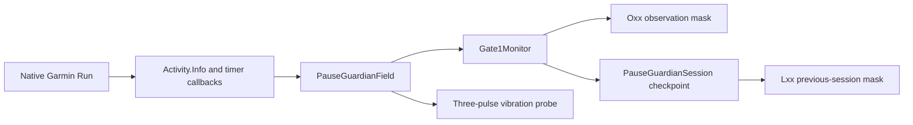

# Architecture

Pause Guardian Gate 1 is a Connect IQ data field embedded in Garmin's native activity experience. It is deliberately small because the Instinct 2 data-field memory budget is 32 KiB and the smallest native field layouts have very limited space.

## Runtime flow



Garmin owns the activity recording and screen navigation. Pause Guardian only observes the data made available to its field and requests a vibration. It has no path that resumes, saves, or edits the activity.

## Components

| File | Responsibility |
| --- | --- |
| `PauseGuardianApp.mc` | Creates the data field, loads stored state, and checkpoints on shutdown |
| `PauseGuardianField.mc` | Receives activity samples and timer events, normalizes inputs, draws the compact value, and requests the vibration probe |
| `Gate1Monitor.mc` | Applies timing, movement, memory, and persistence evidence rules to the observation mask |
| `PauseGuardianSession.mc` | Owns current and previous session state and stores a compact summary |
| `PauseGeo.mc` | Calculates short local distances from scaled coordinates without allocating `Position.Location` objects |
| `Gate1MonitorTests.mc` | Exercises the detector boundaries with Garmin's Run No Evil test framework |
| `PauseGuardianSessionTests.mc` | Exercises checkpoint storage, read-back, reset, and the `Lxx` display window |

## Two timer-state channels

The data field receives timer state through two channels:

1. `Activity.Info.timerState` inside `compute()` is the authoritative sampled state.
2. `onTimerStart`, `onTimerStop`, `onTimerPause`, `onTimerResume`, and `onTimerReset` are lifecycle events.

These channels are kept separate. The public `04` observation is earned only when authoritative activity data reports both manual `STOPPED` and Auto Pause `PAUSED`. Timer callbacks are stored as supporting evidence but cannot manufacture an authoritative state observation.

## Movement evidence

The `02` observation is intentionally conservative. A candidate requires all of the following:

- authoritative manual `STOPPED` state
- a running activity profile
- usable or good GPS quality
- speed of at least 1.4 m/s
- consecutive samples with gaps no greater than two seconds
- six seconds of observation
- at least six metres between the start and end coordinates

The candidate resets when telemetry is missing, GPS is poor, speed is low, the profile is not running, the timer moves backward, a callback gap exceeds two seconds, or three identical speed/location tuples suggest cached data. A six-second window that has not reached six metres is closed rather than allowed to qualify later.

## Vibration probe

After five seconds in manual `STOPPED`, the field requests this pattern once:

```text
500 ms on, 250 ms off, 500 ms on, 250 ms off, 500 ms on
```

The `08` bit records that the API call returned without an exception. Connect IQ does not report whether the wearer physically felt the vibration, so physical confirmation remains outside the automatic mask.

Auto Pause resets the manual-stop probe and must not trigger it.

## Persistence

Checkpoints store a small dictionary containing:

- schema version and build ID
- observation and timer-event masks
- stopped callback count and maximum gap
- maximum sampled memory

Storage is read back immediately to validate the schema, build ID, and stored mask. The live `40` bit is set only after that read-back succeeds. On reset, the completed mask becomes `Lxx` for ten seconds and a new monitor starts with an empty mask.

## Memory and display constraints

- The field uses `WatchUi.SimpleDataField` so Garmin controls layout and clipping.
- The value is limited to `Oxx` or `Lxx` to remain readable in small Instinct 2 slots.
- State is encoded as text, not color, because the Instinct 2 display is monochrome.
- Runtime memory is sampled internally with a 24 KiB threshold, leaving headroom below the 32 KiB data-field ceiling.
- The SDK profiler is still the external source of truth for peak memory validation.

## Product boundary

Gate 1 answers whether this architecture is possible on real firmware. The future reminder detector should only be built if callbacks, fresh telemetry, state distinction, haptics, sleep recovery, and memory all pass the physical checklist.

If the native pause screen suspends the data field or freezes its telemetry, tuning thresholds will not solve the problem. That result would require a different Garmin app architecture or a narrower product promise.
